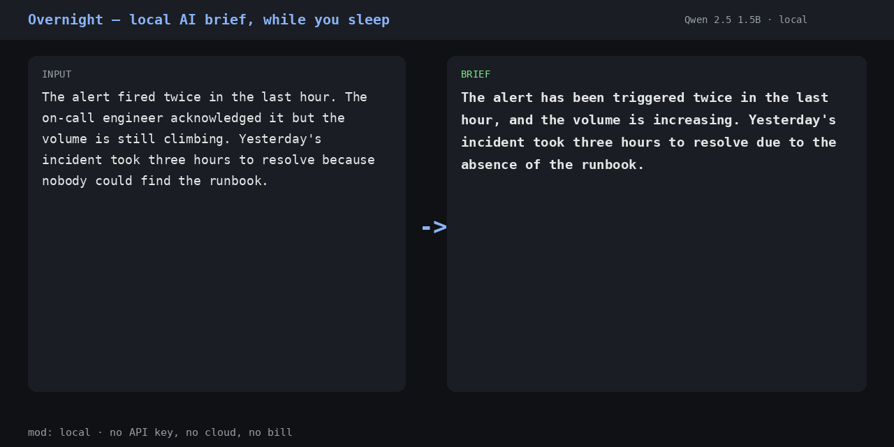
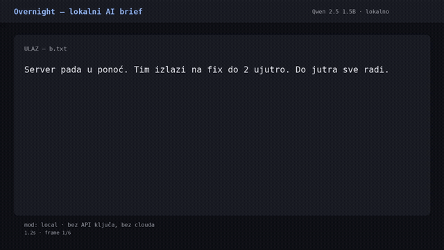

# Overnight

A local agent that does the reading while you sleep — open-weight model, no API key, no cloud.

[](https://github.com/Reggiebro/overnight/actions/workflows/tests.yml)
[](https://www.python.org/)
[](https://ollama.com/)
[](LICENSE)
[](tests/)

<p align="center">
  
</p>

## 📑 Table of Contents

- [🎯 The one-minute pitch](#-the-one-minute-pitch)
- [▶ Watch the demo](#-watch-the-demo)
- [💡 Why this is different](#-why-this-is-different)
- [🚀 Quick start](#-quick-start)
- [🧩 How it works](#-how-it-works)
- [🧪 Tests](#-tests)
- [📖 The backstory](#-the-backstory)
- [😴 The lazy payoff](#-the-lazy-payoff)
- [🏆 Prize categories](#-prize-categories)

## 🎯 The one-minute pitch

You point it at a folder, a URL, or a pile of text. It summarises everything with an **open-weight model running on your own machine**, and leaves a short brief where you will see it in the morning.

No API key. No account. No cloud. No subscription.

The effort it saves is **attention, not time**. It reads the forty things overnight and hands you two lines per item. You open one file instead of forty tabs.

## ▶ Watch the demo

### Live demo

**https://92.5.95.177.sslip.io/overnight-demo/** — paste text, get a two-sentence brief from a local model. Runs on a free Oracle Cloud instance (8 vCPU / 24 GB) with a Qwen 2.5 1.5B GGUF model. Nothing is sent to a provider.

### Video walkthrough

<a href="docs/demo/overnight-demo.mp4">
  
</a>

*Click the GIF for the full video, or [watch the mp4](docs/demo/overnight-demo.mp4).*

## 💡 Why this is different

- **Local, not hosted.** The model is on your disk. A train, a plane, a cabin with no signal — it still runs.
- **Open-weight.** No third party to leak to, no account to suspend, no provider that can change its terms under you.
- **Honest.** The header only says `local mode` when the model actually answered. No model? It says `extractive mode` and takes the first and last sentence — it doesn't pretend.
- **Deterministic.** Same input, same output. These are transformations, not model calls.

## 🚀 Quick start

```bash
git clone https://github.com/Reggiebro/overnight
cd overnight
python3 -m venv .venv && .venv/bin/pip install -r requirements.txt
```

```bash
# find a model automatically (smallest usable GGUF in the usual dirs)
python3 overnight.py --watch ~/inbox --out brief.md

# or be explicit
python3 overnight.py --model ~/.cache/ollama/qwen2.5-1.5b.gguf --watch ~/inbox
```

### Usage

```bash
# a folder of text files
python3 overnight.py --watch ~/inbox

# a single file
python3 overnight.py ~/notes.md

# a URL (markup stripped before the model sees it)
python3 overnight.py https://example.com/news

# stdin
cat report.txt | python3 overnight.py -

# machine-readable output
python3 overnight.py ~/inbox --json
```

## 🧩 How it works

```
You point it at a folder, a URL, or a pile of text
        │
        ▼
┌─────────────────────────┐
│  Read + strip markup    │
└─────────────────────────┘
        │
        ▼
┌─────────────────────────┐
│  Local model (Qwen 2.5) │  ← no API key, no network
└─────────────────────────┘
        │
        ▼
┌─────────────────────────┐
│  Two-line brief per item│
└─────────────────────────┘
        │
        ▼
   morning-brief.md
```

If the model is missing or fails, it falls back to **extractive mode** — the first and last sentence. It never fabricates a summary.

## 🧪 Tests

```bash
python3 -m pytest tests/ -v
```

19 tests pass, including a **no-model smoke test** that verifies the tool still produces a correct extractive brief with no model present. CI is green across three Python versions (3.10, 3.11, 3.12).

## 📖 The backstory

I own a 2011 MEDION E7216 laptop. It has no battery, and it turns itself off.

It doesn't crash — it shuts down *cleanly*, which is the trap. A clean shutdown looks deliberate, so you go looking for a software cause. I checked everything.

The logs said:

```
Oct 22 15:36:15 kernel: thermal thermal_zone0: acpitz: critical temperature reached
Oct 22 15:36:15 kernel: reboot: HARDWARE PROTECTION shutdown (Temperature too high)
```

Four times in one day. Firmware thermal protection: the 2011 BIOS reads an uncalibrated board sensor and trips. The CPU sat at 41-45 °C against a 90 °C critical trip — the CPU was never the problem. The drives were: SMART was logging the Toshiba at 102-120 °C.

So I moved the agent to a free Oracle Cloud instance. That move is why the demo works — I can't demo something on a laptop that may die mid-run.

## 😴 The lazy payoff

I've been running it nightly. The payoff is small and specific: I stopped opening the inbox folder in the morning. I open one file instead of forty tabs, and the day starts without the "read forty things before coffee" tax.

I also stopped fighting a laptop that was dying. The agent moved to hardware that can take the load, and the laptop does the light work it can actually do.

That's the lazy payoff I didn't expect: not just fewer tabs, but one less thing breaking under me.

## 🏆 Prize categories

### Best Use of GitHub Copilot

The automation here is GitHub Actions: the test suite runs automatically on every push across three Python versions (3.10, 3.11, 3.12), plus a no-model smoke test that verifies the tool still produces a correct extractive brief with no model present. CI is green.

### Open-Source AI

The model is Qwen 2.5 1.5B, an open-weight model running entirely on local hardware. No API key, no cloud, no provider that can change its terms under you.

## The honest limits

- The model is Qwen 2.5 1.5B, deliberately tiny so it runs on CPU without a GPU. It's not clever. It will occasionally miss the point. For a real setup you'd swap in something bigger.
- It reads what you point it at. If you point it at a folder of secrets, those secrets stay on your machine — that's the point, not a bug.
- No SLA. This is a free tool on free hardware.

## License

MIT
